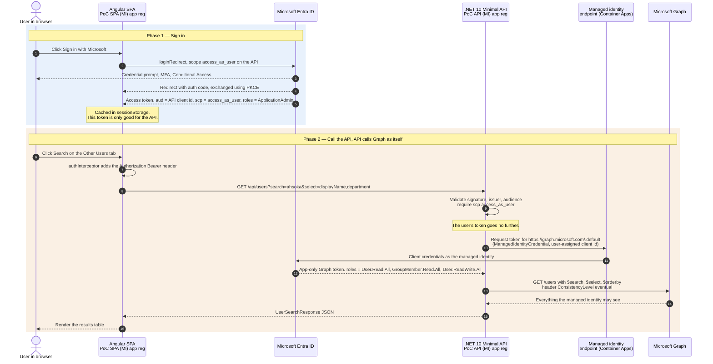
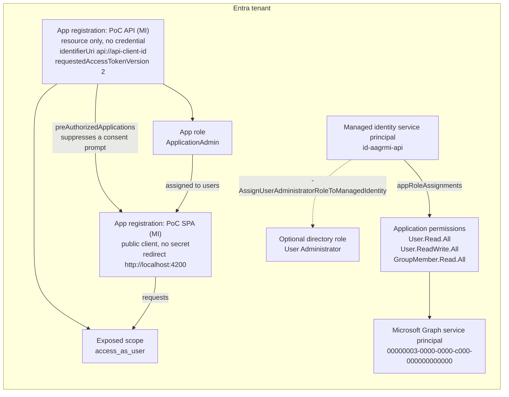
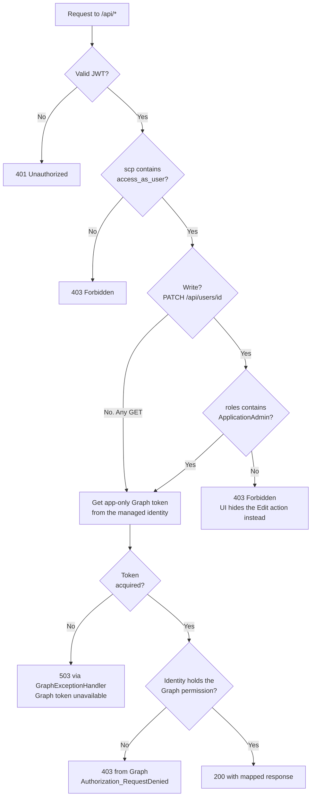

# AAGR — Managed identity implementation

The API calls Microsoft Graph **app-only as its own managed identity**. It validates the SPA's token
to decide who the caller is and what they may do, but never forwards that token: there is no
on-behalf-of exchange, no client secret and no federated credential. The browser never holds a Graph
token.

For the variant where the API calls Graph as the signed-in user, see [../obo-imp](../obo-imp/README.md).

| Path | Contents |
| --- | --- |
| [src/poc-web](src/poc-web) | Angular 21 SPA, `@azure/msal-browser`, no test framework |
| [src/Poc.Api](src/Poc.Api) | .NET 10 minimal API, `Microsoft.Identity.Web` for token validation, `Microsoft.Graph` + `Azure.Identity` for Graph |
| [infra/entra](infra/entra) | Azure CLI scripts that create the two app registrations and grant the managed identity its Graph permissions |
| [infra/azure](infra/azure) | Bicep and a deploy script that host both apps on Azure Container Apps |

The running app carries the same explanation on its **About** tab, which is reachable before you sign in.

> **Security trade-off.** Graph no longer evaluates the caller: every signed-in user with
> `access_as_user` reads the directory with the identity's rights, and the `CanEditUsers` policy
> (`ApplicationAdmin` role) is the only gate on `PATCH /api/users/{id}`.

## How it works

### Runtime flow



`GET /api/me` works the same way, except the API reads the caller's `oid` claim from the validated
token and calls `/users/{oid}`, because an app-only token has no `/me`. Locally the managed-identity
hop is replaced by `AzureCliCredential`, so Graph sees the `az login` account instead.

### Entra ID object model



The **PoC API (MI)** registration only describes the API to callers (scope and app role) and holds no
Graph permissions. The permissions belong to the managed identity's service principal, which is
created with the Azure resource rather than by `setup-entra.ps1`.

### Authorization gate on an inbound request



Things worth calling out:

- **`MapInboundClaims = false` is load bearing.** By default ASP.NET renames the `roles` claim to a
  long WS-Federation URI, which makes `RequireRole("ApplicationAdmin")` fail silently with a `403`
  even when the role is present in the token.
- **The API's policies are the only per-user gate.** Reads and writes use the same app-only token,
  so the `ApplicationAdmin` check is the only thing separating them. Graph's own `403` reflects the
  identity's grants, not the user's rights.

## Endpoints

| Route | Authorization | Graph call (as the managed identity) |
| --- | --- | --- |
| `GET /api/me/context` | `access_as_user` | none (reads token claims) |
| `GET /api/me` | `access_as_user` | `/users/{oid from token}` |
| `GET /api/me/groups` | `access_as_user` | `/users/{oid from token}/memberOf` |
| `GET /api/users/properties` | `access_as_user` | none (static catalog) |
| `GET /api/users?search=&top=` | `access_as_user` | `/users?$search=` |
| `GET /api/users/{id}` | `access_as_user` | `/users/{id}` |
| `GET /api/users/{id}/groups` | `access_as_user` | `/users/{id}/memberOf` |
| `PATCH /api/users/{id}` | `access_as_user` + `ApplicationAdmin` role | `PATCH /users/{id}` |

Query and route parameters are bound to `[AsParameters]` models in
[src/Poc.Api/Models/Requests.cs](src/Poc.Api/Models/Requests.cs) and validated by
`builder.Services.AddValidation()`. Failures return `400` with `ValidationProblemDetails`
before the endpoint body runs, which also keeps unvetted input out of the Graph `$search` expression.

## Prerequisites

- PowerShell and Azure CLI for the Entra and deployment scripts.
- .NET 10 SDK for the API and Node.js/npm compatible with Angular 21 for the SPA.
- For local sign-in, an Entra tenant where you can create the app registrations. The API's local
  Graph calls use the signed-in Azure CLI account; that account must have the directory access
  needed for the Graph operation being tested.
- For Azure deployment, the shared resources in the tables below must already exist. `rg-apps`
  and `rg-platform` must be in the same subscription; select that subscription with
  `az account set --subscription <subscription-id>` before deploying. The script does not create
  the shared registry, pull identity, Container Apps environment, or Log Analytics workspace.
- No local Docker installation is needed; the deployment builds images with `az acr build`.

## 1. Create the Entra ID app registrations

Requires **Application Administrator** to create the apps.

```powershell
az login --tenant <your-tenant-id>
cd mi-imp/infra/entra
./setup-entra.ps1 -AssignAdminRoleToCurrentUser -ApplyLocalConfig
```

What the script does:

1. Creates **PoC API (MI)** — exposes the `access_as_user` scope and defines the `ApplicationAdmin`
   app role. No client secret, no federated credential, no Graph permissions.
2. Creates **PoC SPA (MI)** — SPA redirect URI `http://localhost:4200`, permission to call
   `access_as_user`, and is pre-authorized on the API so users see a single consent prompt.
3. Grants admin consent for SPA → API.
4. `-AssignAdminRoleToCurrentUser` assigns you the `ApplicationAdmin` app role.
5. `-ApplyLocalConfig` writes the ids into `src/poc-web/src/environments/environment.ts` and stores
   the tenant id, client id and Graph endpoint in `dotnet user-secrets` (there is no secret to store).

Ids are also saved to `infra/entra/entra-output.json` (git-ignored). `-ApplyLocalConfig` configures
both the SPA and the API's `dotnet user-secrets`; it is the recommended local setup. If you omit it,
copy [environment.sample.ts](src/poc-web/src/environments/environment.sample.ts) to
`environment.ts` and fill in its placeholders, then set the API user-secrets from
`entra-output.json` (the authority host, tenant id, API client id, and Graph base URL):

```powershell
cd mi-imp/src/Poc.Api
dotnet user-secrets init
dotnet user-secrets set "AzureAd:Instance" "<authorityHost>"
dotnet user-secrets set "AzureAd:TenantId" "<tenantId>"
dotnet user-secrets set "AzureAd:ClientId" "<apiClientId>"
dotnet user-secrets set "MicrosoftGraph:BaseUrl" "<graphBaseUrl>"
```

Without both configurations, the SPA will not build and the API will not be configured for
authentication.

The managed identity does not exist until the first deploy, so its Graph permissions are granted in
[step 4](#4-deploy-to-azure). Remove the app registrations with `./teardown-entra.ps1`.

## 2. Run the API

```powershell
dotnet dev-certs https --trust    # once per machine
cd mi-imp/src/Poc.Api
dotnet run --launch-profile https
```

Listens on `https://localhost:7182`. OpenAPI document at `/openapi/v1.json` in Development.

There is no managed identity on a dev machine, so in `Development` the API uses `AzureCliCredential`
and Graph sees **your** `az login` account (delegated, limited by your own directory rights and the
Graph access available to that account). The app-only behaviour only exists once deployed.

## 3. Run the SPA

```powershell
cd mi-imp/src/poc-web
npm install
npm start
```

Open `http://localhost:4200`. The **About** tab explains the flow without signing in.

## 4. Deploy to Azure

Both apps run on a shared Azure Container Apps environment (consumption plan, scale to zero) in
**northcentralus**. The deployment reuses existing shared resources and only adds this
implementation's identities and container apps. Defined in [infra/azure/main.bicep](infra/azure/main.bicep).

Shared resources (must already exist, referenced only):

| Resource group | Resource | Notes |
| --- | --- | --- |
| `rg-platform` | `acccrshared` container registry | images are built in the registry with `az acr build` as `aagrmi-api` / `aagrmi-spa`, no local Docker needed |
| `rg-platform` | `id-shared-acrpull` user-assigned identity | holds only `AcrPull` on `acccrshared`; attached to every container app and used for image pulls |
| `rg-apps` | `cae-shared` Container Apps environment | already sends container logs to `law-shared` |
| `rg-apps` | `law-shared` Log Analytics workspace | not referenced by the Bicep; wired through the environment |

Created in `rg-apps`:

| Resource | Notes |
| --- | --- |
| `id-aagrmi-api` user-assigned identity | the API's identity for Graph; no registry access |
| `id-aagrmi-spa` user-assigned identity | the SPA's workload identity; no registry access |
| `ca-aagrmi-api` container app | .NET API, 0.25 vCPU / 0.5 GiB, 0&ndash;1 replicas; identities `id-aagrmi-api` + `id-shared-acrpull` |
| `ca-aagrmi-spa` container app | nginx serving the built SPA, same sizing; identities `id-aagrmi-spa` + `id-shared-acrpull` |

The per-app identities are user-assigned and live in `rg-apps` rather than being system-assigned, so
their ids, Graph app-role assignments and directory role survive deleting or replacing a container
app. Registry access stays on the one narrowly scoped `id-shared-acrpull`.

The deployment account needs:

- Contributor on `rg-apps` to create the per-app identities and Container Apps.
- Read access to the shared resources it references, plus permission to queue `az acr build` runs
  and push the resulting images to `acccrshared`. With standard registry RBAC, this typically means
  `AcrPush` plus `Microsoft.ContainerRegistry/registries/scheduleRun/action`; use equivalent
  permissions if the registry uses a different RBAC mode.
- Managed Identity Operator on `id-shared-acrpull` so the deployment can attach it to the apps.

No role assignments are created by this deployment. It does not need Contributor on `rg-platform`.

### 4.1 Select the Azure cloud and subscription

Use the same Entra tenant and cloud as step 1, and select the subscription containing both resource
groups. For Azure Government, select the cloud before signing in:

```powershell
az cloud set --name AzureUSGovernment
az login --tenant <your-tenant-id>
az account set --subscription <subscription-id>
```

For Azure public cloud, omit the `az cloud set` command. The deploy script does not create the
shared resources listed above; confirm they exist in the selected subscription before continuing.

### 4.2 Deploy the Container Apps and build the images

```powershell
cd mi-imp/infra/azure
./deploy.ps1
```

The script deploys the API and SPA identities first, builds both images in ACR, then deploys the
container apps. It prints the API and SPA URLs and a follow-up Entra command at the end. Defaults
are `rg-apps` / `rg-platform`, `northcentralus`, and the `aagrmi` name prefix.

The account running **`deploy.ps1`** needs these Azure RBAC permissions:

| Scope | Permission | Why it is needed |
| --- | --- | --- |
| `rg-apps` | Contributor | Create the two user-assigned identities and the Container Apps. |
| Shared Container Apps environment and referenced shared resources | Read access | Look up the existing environment, registry, and pull identity. Contributor on `rg-apps` covers the environment; the resources in `rg-platform` need separate read access. |
| `id-shared-acrpull` | Managed Identity Operator | Attach the shared image-pull identity to both apps. |
| `acccrshared` | Permission to queue ACR builds and push images | Build the API and SPA images. With standard registry RBAC, this is typically `AcrPush` plus `Microsoft.ContainerRegistry/registries/scheduleRun/action`; use equivalent permissions for the registry's RBAC mode. |

These are permissions for the deploying account, not assignments made by the script. No Contributor
access to all of `rg-platform` is required.

### 4.3 Grant the API managed identity access to Microsoft Graph

After the deployment, run the **`setup-entra.ps1` command printed by `deploy.ps1`**. It includes the
API identity's resource ID and the deployed SPA URL; run it as printed so the redirect URI matches
the deployed app. From the repository root, the equivalent command shape is:

```powershell
cd mi-imp/infra/entra
./setup-entra.ps1 -ApplyLocalConfig `
    -ManagedIdentityResourceId <api-identity-resource-id> `
    -AdditionalSpaRedirectUris <deployed-spa-url>
```

The account running **`setup-entra.ps1`** needs:

| Entra/Azure scope | Role or permission | Why it is needed |
| --- | --- | --- |
| **PoC API (MI)** and **PoC SPA (MI)** app registrations | Application Administrator, or an owner with permission to update the registrations | Update the SPA redirect URI and API registration. |
| API identity in Azure | Read the user-assigned identity | Resolve its principal ID for the Graph grants. |
| Entra tenant | Privileged Role Administrator or Global Administrator | Grant Microsoft Graph application permissions to the managed identity. |

The last permission is required for the default Graph grants below. If the person running the
command cannot grant them, ask a Privileged Role Administrator or Global Administrator to rerun the
printed command. The script is idempotent; it skips grants that are already present. Add
`-AssignUserAdministratorRoleToManagedIdentity` only when the API must edit properties Graph
protects behind a directory role; assigning that directory role also requires Privileged Role
Administrator or Global Administrator.

The default Microsoft Graph **application** permissions granted to the API identity are:

| Permission | Used by |
| --- | --- |
| `User.Read.All` | `/api/me`, `/api/users` search and lookup |
| `GroupMember.Read.All` | `/api/me/groups`, `/api/users/{id}/groups` |
| `User.ReadWrite.All` | `PATCH /api/users/{id}` |

- Trim the list with `-ManagedIdentityGraphAppRoles`, e.g. drop `User.ReadWrite.All` for read-only.
- Managed identity tokens are cached for up to 24 hours; restart the API revision after changing grants.

`-ApplyLocalConfig` also refreshes the local SPA configuration and API user-secrets. Once the Entra
command succeeds, open the printed SPA URL and sign in to verify the deployment. A Graph `403` means
the Graph application grant or (for protected edits) the optional directory role is missing; a
failed token acquisition can also occur while newly granted permissions propagate.

Sizing, replica count and the shared resource names are parameters (`-ContainerCpu`,
`-ContainerMemory`, `-MaxReplicas`, `-NamePrefix`, `-ResourceGroup`, `-ContainerAppsEnvironment`,
`-PlatformResourceGroup`, `-ContainerRegistry`, `-AcrPullIdentity`). `-Location` must match the
environment's region; the script checks it. For Azure Government, switch the CLI cloud, point the
script at that cloud's shared resources and repeat steps 4.1–4.3 there; the authority and Graph
endpoint follow the cloud:

```powershell
az cloud set --name AzureUSGovernment; az login
./deploy.ps1 -Location usgovvirginia -ResourceGroup rg-apps-gov -PlatformResourceGroup rg-platform-gov `
    -ContainerRegistry <gov-registry> -ContainerAppsEnvironment <gov-environment>
```

- The first request after the apps scale to zero takes several seconds while a replica starts.
- Removing the deployment means deleting `ca-aagrmi-api`, `ca-aagrmi-spa`, `id-aagrmi-api` and
  `id-aagrmi-spa` from `rg-apps` (and the `aagrmi-api` / `aagrmi-spa` repositories if wanted) &mdash; never the
  resource groups, which hold other apps.

## Configuration reference

`src/Poc.Api/appsettings.json` holds non-secret defaults; local values live in user-secrets and the
deployed values are set by the Bicep.

| Key | Value |
| --- | --- |
| `AzureAd:Instance` | Entra ID authority host for the cloud |
| `AzureAd:TenantId` | directory (tenant) id |
| `AzureAd:ClientId` | **PoC API (MI)** application (client) id, used only to validate inbound tokens |
| `MicrosoftGraph:BaseUrl` | Graph endpoint for the cloud; the `.default` scope is derived from it |
| `ManagedIdentity:ClientId` | user-assigned identity's client id; omit for a system-assigned identity |
| `Cors:AllowedOrigins` | origins allowed to call the API |

## Notes for moving beyond a PoC

- Grant the identity the narrowest Graph permissions the deployment needs; app-only permissions are
  tenant-wide.
- Consider restricting reads by role as well, since Graph no longer filters by the caller.
- The SPA stores tokens in `sessionStorage`; evaluate that against your threat model.
