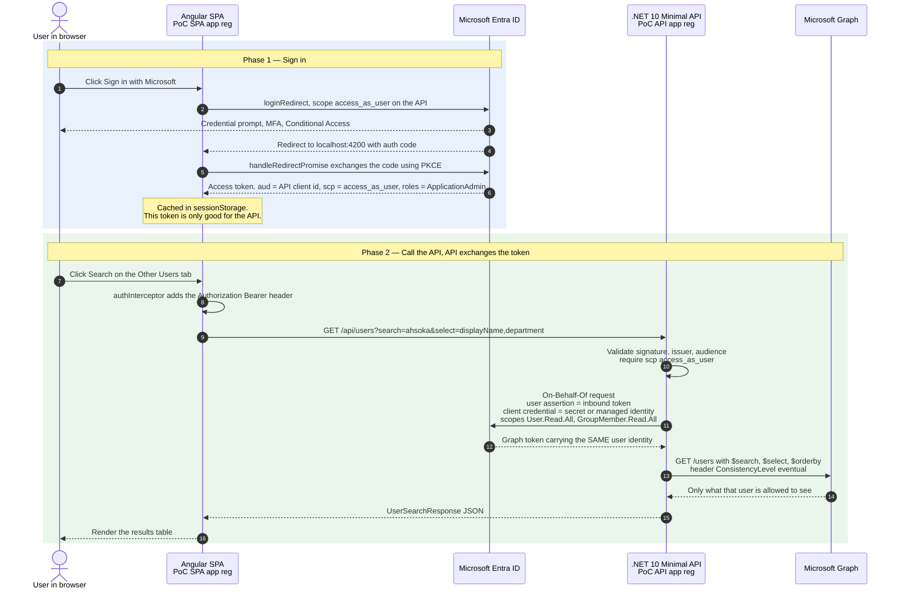
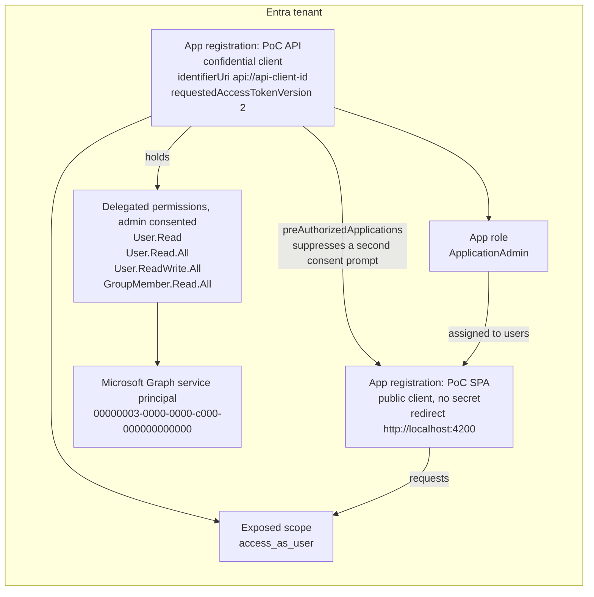
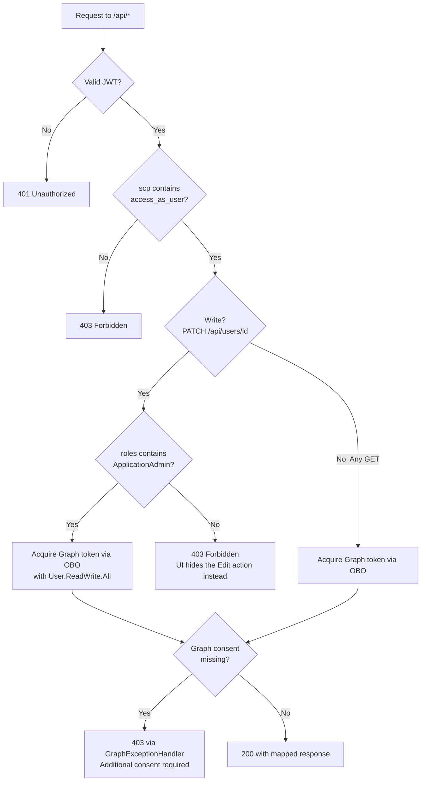

# AAGR — On-Behalf-Of implementation

The API calls Microsoft Graph **as the signed-in user**. It validates the SPA's token, exchanges it
through the on-behalf-of (OBO) flow for a delegated Graph token, and calls Graph with that. The
browser never holds a Graph token.

For the variant where the API calls Graph as its own managed identity, see [../mi-imp](../mi-imp/README.md).

| Path | Contents |
| --- | --- |
| [src/poc-web](src/poc-web) | Angular 21 SPA, `@azure/msal-browser`, no test framework |
| [src/Poc.Api](src/Poc.Api) | .NET 10 minimal API, `Microsoft.Identity.Web` with OBO token acquisition |
| [infra/entra](infra/entra) | Azure CLI scripts that create the two app registrations |
| [infra/azure](infra/azure) | Bicep and a deploy script that host both apps on Azure Container Apps |

The running app carries the same explanation on its **About** tab, which is reachable before you sign in.

## How it works

### Runtime flow



The point of the exchange in phase 2: the browser never holds a Graph token. If the SPA were
compromised, the stolen token only opens this API — an attacker cannot turn around and call Graph
directly with it.

### Entra ID object model



Both registrations are created by `setup-entra.ps1`. The SPA holds no secret and no Graph
permissions at all — every Graph permission lives on the API registration.

### Authorization gate on an inbound request



Things worth calling out:

- **`MapInboundClaims = false` is load bearing.** By default ASP.NET renames the `roles` claim to a
  long WS-Federation URI, which makes `RequireRole("ApplicationAdmin")` fail silently with a `403`
  even when the role is present in the token.
- **Reads are open, writes are gated.** Any signed-in user may search and read profiles, as they
  can in Outlook or Teams. `User.ReadWrite.All` is a *delegated* permission with tenant-wide admin
  consent, so the `ApplicationAdmin` check on `PATCH /api/users/{id}` is what stops ordinary users
  from reaching it. The write scope is requested only for that call, so read tokens stay read-only.
- **Graph still checks the user.** Delegated permissions are capped by the caller's own directory
  privileges, so editing another user also needs an Entra directory role such as
  **User Administrator**. Without one, Graph returns `403 Insufficient privileges`.

## Endpoints

| Route | Authorization | Graph call |
| --- | --- | --- |
| `GET /api/me/context` | `access_as_user` | none (reads token claims) |
| `GET /api/me` | `access_as_user` | `/me` |
| `GET /api/me/groups` | `access_as_user` | `/me/memberOf` |
| `GET /api/users/properties` | `access_as_user` | none (static catalog) |
| `GET /api/users?search=&top=` | `access_as_user` | `/users?$search=` |
| `GET /api/users/{id}` | `access_as_user` | `/users/{id}` |
| `GET /api/users/{id}/groups` | `access_as_user` | `/users/{id}/memberOf` |
| `PATCH /api/users/{id}` | `access_as_user` + `ApplicationAdmin` role | `PATCH /users/{id}` |

The by-id routes back the **Details** and **Edit** actions on each row of the search results in the
**Other Users** tab. The edit form sends display name, given name, surname, job title, department,
office and mobile phone; a blank field clears that property in the directory.

Query and route parameters are bound to `[AsParameters]` models in
[src/Poc.Api/Models/Requests.cs](src/Poc.Api/Models/Requests.cs) and validated by
`builder.Services.AddValidation()`. Failures return `400` with `ValidationProblemDetails`
before the endpoint body runs, which also keeps unvetted input out of the Graph `$search` expression.

## Prerequisites

- PowerShell and Azure CLI for the Entra and deployment scripts.
- .NET 10 SDK for the API and Node.js/npm compatible with Angular 21 for the SPA.
- An Entra tenant where you can create the app registrations. Admin consent for the requested
  Microsoft Graph delegated permissions requires Privileged Role Administrator or Global
  Administrator.
- For Azure deployment, the shared resources in the tables below must already exist. `rg-apps`
  and `rg-platform` must be in the same subscription; select that subscription with
  `az account set --subscription <subscription-id>` before deploying. The script does not create
  the shared registry, pull identity, Container Apps environment, or Log Analytics workspace.
- No local Docker installation is needed; the deployment builds images with `az acr build`.

## 1. Create the Entra ID app registrations

Creating and configuring the app registrations requires **Application Administrator** (or
equivalent app-registration ownership). Granting admin consent for the Graph delegated permissions
requires **Privileged Role Administrator** or **Global Administrator**. The script reports consent
failures if that grant cannot be completed.

```powershell
az login --tenant <your-tenant-id>
cd obo-imp/infra/entra
./setup-entra.ps1 -AssignAdminRoleToCurrentUser -ApplyLocalConfig
```

What the script does:

1. Creates **PoC API** — exposes the `access_as_user` scope, defines the `ApplicationAdmin`
   app role, requests the delegated Graph permissions `User.Read`, `User.Read.All`,
   `User.ReadWrite.All`, `GroupMember.Read.All`, and issues a client secret for the OBO exchange.
2. Creates **PoC SPA** — SPA redirect URI `http://localhost:4200`, permission to call
   `access_as_user`, and is pre-authorized on the API so users see a single consent prompt.
3. Grants admin consent for both registrations.
4. `-AssignAdminRoleToCurrentUser` assigns you the `ApplicationAdmin` app role.
5. `-ApplyLocalConfig` writes the ids into `src/poc-web/src/environments/environment.ts`
   and stores the tenant id, client id and client secret in `dotnet user-secrets`.

Ids are also saved to `infra/entra/entra-output.json` (git-ignored). Without
`-ApplyLocalConfig` the script prints the `dotnet user-secrets set` commands to run yourself.

`environment.ts` is git-ignored because its ids are tenant-specific. If you skip
`-ApplyLocalConfig`, copy
[environment.sample.ts](src/poc-web/src/environments/environment.sample.ts) to `environment.ts`
and fill in the placeholders &mdash; the SPA will not build without it.

To assign `ApplicationAdmin` to someone else: **Entra ID → Enterprise applications → PoC API →
Users and groups → Add user/group**. The role only appears in the token after the user signs in again.

Remove everything with `./teardown-entra.ps1`.

## 2. Run the API

```powershell
dotnet dev-certs https --trust    # once per machine
cd obo-imp/src/Poc.Api
dotnet run --launch-profile https
```

Listens on `https://localhost:7182`. OpenAPI document at `/openapi/v1.json` in Development.

## 3. Run the SPA

```powershell
cd obo-imp/src/poc-web
npm start
```

Open `http://localhost:4200`. The **About** tab explains the flow without signing in. Sign in, then
choose **Request my Entra info** on the **My Information** tab, or search on **Other Users**. If your
account holds the `ApplicationAdmin` role, an **Edit** action appears on each user's details.

## 4. Deploy to Azure

Both apps run on a shared Azure Container Apps environment (consumption plan, scale to zero) in
**northcentralus**. The deployment reuses existing shared resources and only adds this
implementation's identities and container apps. Defined in [infra/azure/main.bicep](infra/azure/main.bicep).

Shared resources (must already exist, referenced only):

| Resource group | Resource | Notes |
| --- | --- | --- |
| `rg-platform` | `acccrshared` container registry | images are built in the registry with `az acr build` as `aagrobo-api` / `aagrobo-spa`, no local Docker needed |
| `rg-platform` | `id-shared-acrpull` user-assigned identity | holds only `AcrPull` on `acccrshared`; attached to every container app and used for image pulls |
| `rg-apps` | `cae-shared` Container Apps environment | already sends container logs to `law-shared` |
| `rg-apps` | `law-shared` Log Analytics workspace | not referenced by the Bicep; wired through the environment |

Created in `rg-apps`:

| Resource | Notes |
| --- | --- |
| `id-aagrobo-api` user-assigned identity | used as the API's federated credential for OBO after the Entra follow-up step; no registry access |
| `id-aagrobo-spa` user-assigned identity | the SPA's workload identity; no registry access |
| `ca-aagrobo-api` container app | .NET API, 0.25 vCPU / 0.5 GiB, 0&ndash;1 replicas; identities `id-aagrobo-api` + `id-shared-acrpull` |
| `ca-aagrobo-spa` container app | nginx serving the built SPA, same sizing; identities `id-aagrobo-spa` + `id-shared-acrpull` |

The per-app identities are user-assigned and live in `rg-apps` rather than being system-assigned, so
their ids &mdash; and the federated credential that trusts `id-aagrobo-api` &mdash; survive deleting
or replacing a container app. Registry access stays on the one narrowly scoped `id-shared-acrpull`.

The deployment account needs:

- Contributor on `rg-apps` to create the per-app identities and Container Apps.
- Read access to the shared resources it references, plus permission to queue `az acr build` runs
  and push the resulting images to `acccrshared`. With standard registry RBAC, this typically means
  `AcrPush` plus `Microsoft.ContainerRegistry/registries/scheduleRun/action`; use equivalent
  permissions if the registry uses a different RBAC mode.
- Managed Identity Operator on `id-shared-acrpull` so the deployment can attach it to the apps.

No role assignments are created by this deployment. It does not need Contributor on `rg-platform`.

### 4.1 Select the Azure cloud and subscription

Use the same Entra tenant and cloud as step 1, and select the subscription containing both resource
groups. For Azure Government, select the cloud before signing in:

```powershell
az cloud set --name AzureUSGovernment
az login --tenant <your-tenant-id>
az account set --subscription <subscription-id>
```

For Azure public cloud, omit the `az cloud set` command. The deploy script does not create the
shared resources listed above; confirm they exist in the selected subscription before continuing.

### 4.2 Deploy the Container Apps and build the images

```powershell
cd obo-imp/infra/azure
./deploy.ps1
```

The script deploys the API and SPA identities first, builds both images in ACR, then deploys the
container apps. It prints the API and SPA URLs and a follow-up Entra command at the end. Defaults
are `rg-apps` / `rg-platform`, `northcentralus`, and the `aagrobo` name prefix.

The account running **`deploy.ps1`** needs these Azure RBAC permissions:

| Scope | Permission | Why it is needed |
| --- | --- | --- |
| `rg-apps` | Contributor | Create the two user-assigned identities and the Container Apps. |
| Shared Container Apps environment and referenced shared resources | Read access | Look up the existing environment, registry, and pull identity. Contributor on `rg-apps` covers the environment; the resources in `rg-platform` need separate read access. |
| `id-shared-acrpull` | Managed Identity Operator | Attach the shared image-pull identity to both apps. |
| `acccrshared` | Permission to queue ACR builds and push images | Build the API and SPA images. With standard registry RBAC, this is typically `AcrPush` plus `Microsoft.ContainerRegistry/registries/scheduleRun/action`; use equivalent permissions for the registry's RBAC mode. |

These are permissions for the deploying account, not assignments made by the script. No Contributor
access to all of `rg-platform` is required.

### 4.3 Register the API identity for on-behalf-of token exchange

After the deployment, run the **`setup-entra.ps1` command printed by `deploy.ps1`**. It includes the
API identity's resource ID and the deployed SPA URL; run it as printed so the redirect URI matches
the deployed app. From the repository root, the equivalent command shape is:

```powershell
cd obo-imp/infra/entra
./setup-entra.ps1 -ApplyLocalConfig -ConfigureFederatedCredential `
    -ManagedIdentityResourceId <api-identity-resource-id> `
    -AdditionalSpaRedirectUris <deployed-spa-url>
```

The account running **`setup-entra.ps1`** needs:

| Entra/Azure scope | Role or permission | Why it is needed |
| --- | --- | --- |
| API identity in Azure | Read the user-assigned identity | Resolve its principal ID and client ID for the federated credential. |
| **PoC API** app registration | Application Administrator, or an owner with permission to manage credentials | Create the federated identity credential on the API registration. |
| **PoC SPA** app registration | Application Administrator, or an owner with permission to update the registration | Add the deployed SPA URL as a redirect URI. |

This step does **not** grant Microsoft Graph permissions; those delegated permissions were consented
in step 1. `-ApplyLocalConfig` also refreshes the local SPA configuration and resets the API client
secret, storing its new value in local user-secrets. Azure uses the federated credential, not this
secret. The Entra command must succeed before the deployed API can exchange tokens and call Graph.

### 4.4 Verify the deployment

Open the printed SPA URL, sign in, then try the profile or user-search flow. Delegated Graph access
is still subject to the signed-in user's directory permissions. Editing additionally requires the
user's `ApplicationAdmin` app role (assigned in step 1) and any applicable Entra directory role, such
as User Administrator. Re-running `deploy.ps1` rebuilds and deploys the images but does **not** repeat
the Entra federation and redirect-URI setup; rerun the printed `setup-entra.ps1` command if that
configuration needs to be restored.

Sizing, replica count and the shared resource names are parameters (`-ContainerCpu`,
`-ContainerMemory`, `-MaxReplicas`, `-NamePrefix`, `-ResourceGroup`, `-ContainerAppsEnvironment`,
`-PlatformResourceGroup`, `-ContainerRegistry`, `-AcrPullIdentity`). `-Location` must match the
environment's region; the script checks it. For Azure Government, switch the CLI cloud, point the
script at that cloud's shared resources and repeat steps 4.1–4.4 there; the authority, Graph endpoint
and token-exchange audience follow the cloud:

```powershell
az cloud set --name AzureUSGovernment; az login
./deploy.ps1 -Location usgovvirginia -ResourceGroup rg-apps-gov -PlatformResourceGroup rg-platform-gov `
    -ContainerRegistry <gov-registry> -ContainerAppsEnvironment <gov-environment>
```

- The first request after the apps scale to zero takes several seconds while a replica starts.
- Removing the deployment means deleting `ca-aagrobo-api`, `ca-aagrobo-spa`, `id-aagrobo-api` and
  `id-aagrobo-spa` from `rg-apps` (and the `aagrobo-api` / `aagrobo-spa` repositories if wanted) &mdash; never the
  resource groups, which hold other apps.
- Re-running `setup-entra.ps1` resets the API client secret; include `-ApplyLocalConfig` so local
  development picks up the new one.

## Configuration reference

`src/Poc.Api/appsettings.json` holds non-secret defaults; real values belong in user-secrets.

| Key | Value |
| --- | --- |
| `AzureAd:Instance` | Entra ID authority host for the cloud |
| `AzureAd:TenantId` | directory (tenant) id |
| `AzureAd:ClientId` | **PoC API** application (client) id |
| `AzureAd:ClientCredentials` | how the API proves its identity — see below |
| `MicrosoftGraph:BaseUrl` | Graph endpoint for the cloud |
| `MicrosoftGraph:Scopes` | delegated scopes requested during the OBO exchange |
| `Cors:AllowedOrigins` | origins allowed to call the API |

The API accepts v2 access tokens whose audience is either the API client id or
`api://<api-client-id>`; `Microsoft.Identity.Web` configures both, so no `Audience` entry is needed.

### Client credentials

The on-behalf-of flow requires a confidential client, so the API must hold a credential. Which one
depends on the environment, and `appsettings.json` deliberately declares none — an entry there would
merge with (rather than replace) the per-environment entry and leave a stale key behind.

| Environment | Credential | Where it comes from |
| --- | --- | --- |
| Local | client secret | `dotnet user-secrets`, written by `setup-entra.ps1 -ApplyLocalConfig` |
| Deployed | user-assigned managed identity | Container Apps settings supplied by `main.bicep`, no secret anywhere |

The deployed path uses a federated identity credential: the managed identity is registered on the app
registration, so it can act as the app without a secret or certificate to rotate. `deploy.ps1` creates
the user-assigned identity and `main.bicep` configures the API to use its client id and the active
cloud's token-exchange audience. After the first deploy, run the Entra follow-up command printed by
the script to create the federated credential; do not copy the printed settings into
`appsettings.Production.json`.

To configure federation separately, create the identity first, then run:

```powershell
./setup-entra.ps1 -ConfigureFederatedCredential `
  -ManagedIdentityResourceId /subscriptions/<sub>/resourceGroups/rg-apps/providers/Microsoft.ManagedIdentity/userAssignedIdentities/id-aagrobo-api
```

The script resolves the identity's principal id (the federation subject) and client id, picks the
token-exchange audience for the active cloud, and prints the resulting configuration for reference.
The checked-in Container Apps deployment uses a user-assigned identity. A system-assigned identity
would require changing the Bicep identity configuration as well; passing its principal id to this
script alone does not switch the deployed app to a system-assigned identity.

### Sovereign clouds

No endpoint is hard-coded. `setup-entra.ps1` reads the Graph endpoint and the Entra ID authority from
the CLI's active cloud, then writes them into `environment.ts` (`authorityHost`) and user-secrets
(`AzureAd:Instance`, `MicrosoftGraph:BaseUrl`). For Azure Government:

```powershell
az cloud set --name AzureUSGovernment
az login --tenant <tenant-id>
./setup-entra.ps1 -AssignAdminRoleToCurrentUser -ApplyLocalConfig
```

Pass `-GraphResourceUrl` / `-AuthorityHost` to override either value for a cloud the CLI does not
describe.

## Notes for moving beyond a PoC

- Replace the client secret with a certificate or workload identity federation
  (`AzureAd:ClientCredentials` supports both) — see [Client credentials](#client-credentials).
- Swap `AddInMemoryTokenCaches()` for a distributed cache.
- The SPA stores tokens in `sessionStorage`; evaluate that against your threat model.
